# Python Turtle Graphics: Self-Study Portfolio

Small Python programs from my self-study, started in 2023: mostly generative art drawn with the standard-library `turtle` module, plus a few console programs. Every drawing sits next to a screenshot of its output.

[](https://www.python.org/downloads/)
[](https://docs.python.org/3/library/turtle.html)
[](https://peps.python.org/pep-0008/)
[](LICENSE)

<p align="center">
  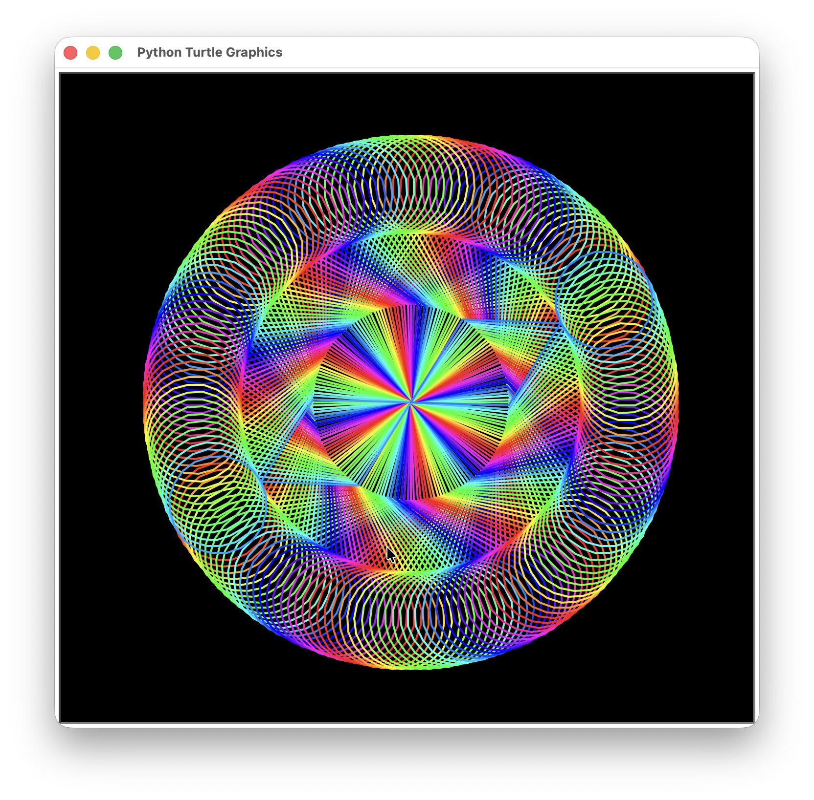
  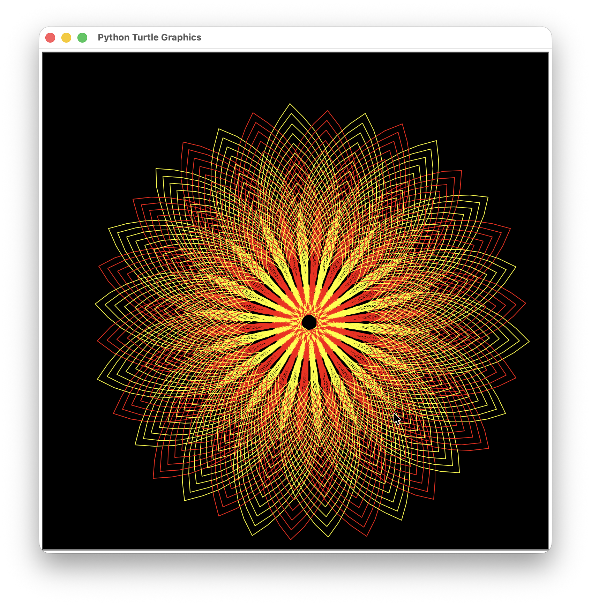
  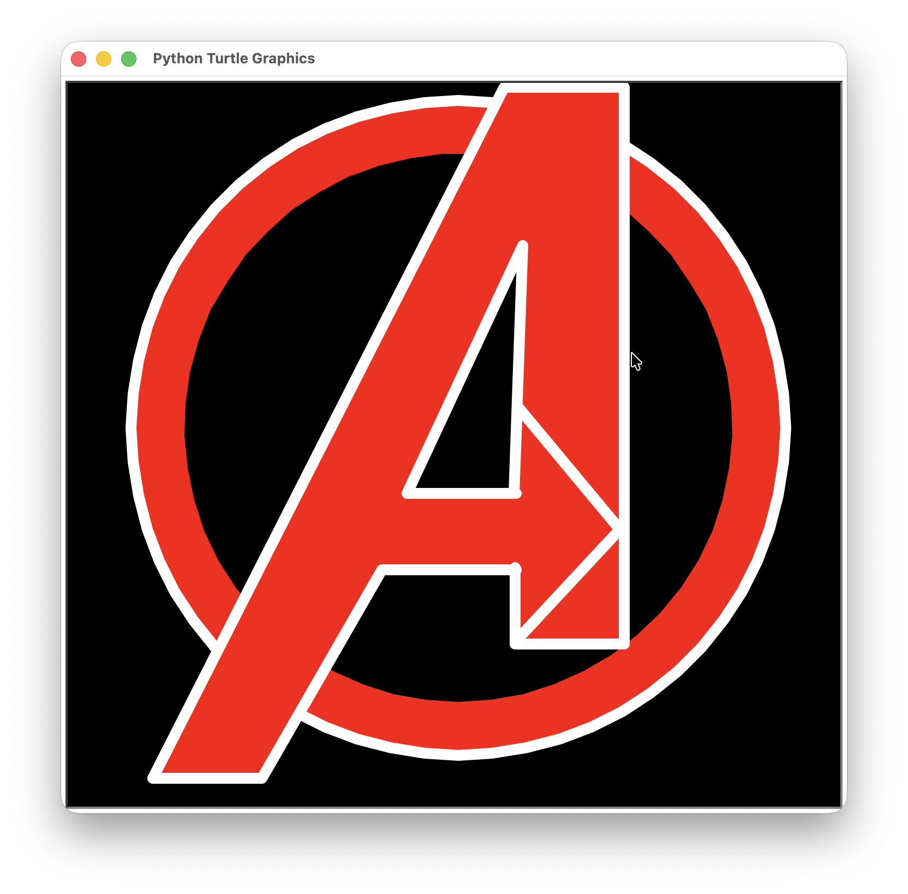
</p>

## Contents

- [Quick start](#quick-start)
- [Gallery](#gallery)
- [Console programs](#console-programs)
- [What I practiced](#what-i-practiced)
- [Code style](#code-style)
- [License](#license)

## Quick start

```bash
git clone https://github.com/Shahin-H2/Turtle-Lib-Practices-2023.git
cd Turtle-Lib-Practices-2023
python3 spirals/rainbow_hexagon_spiral.py
```

- **Requirements:** Python 3.8+ with Tkinter (included with the python.org installers; `brew install python-tk` on Homebrew, `sudo apt install python3-tk` on Debian/Ubuntu).
- **Running:** each turtle script opens a window; close it to exit. On Windows, use `py` instead of `python3`.
- **One extra package:** only `basics/break_reminder.py` needs one, so run `pip install -r requirements.txt` to install plyer (on macOS, plyer also needs `pyobjus`).

<details>
<summary>View folder structure</summary>

```text
Turtle-Lib-Practices-2023/
├── basics/            # Small console programs
├── games/             # Text-based console games
├── logos/             # Turtle drawings: logo recreations
├── patterns/          # Turtle drawings: geometric patterns
├── spirals/           # Turtle drawings: spirals from repeated turns
├── LICENSE
├── README.md
└── requirements.txt   # plyer, for basics/break_reminder.py only
```

Each script sits next to a screenshot with the same base name, for example `patterns/chessboard.py` and `patterns/chessboard.png`.

</details>

## Gallery

### Logos

| Preview | Script |
| :---: | :--- |
|  | **[Avengers Logo](logos/avengers_logo.py)**<br>The Avengers "A" over a red ring, built by layering filled shapes and painting the ring's center and the letter's hole in the background color.<br><br>**Concepts:** `filled shapes` `layering` `helper functions`<br>**Run:** `python3 logos/avengers_logo.py` |
|  | **[Windows Logo](logos/windows_logo.py)**<br>The four-pane Windows logo, drawn as one blue shape in perspective and cut into panes with thick lines in the background color.<br><br>**Concepts:** `goto()` `filled polygons` `pen width`<br>**Run:** `python3 logos/windows_logo.py` |

*Fan-made recreations for learning; the logos are trademarks of their respective owners.*

### Patterns

| Preview | Script |
| :---: | :--- |
| 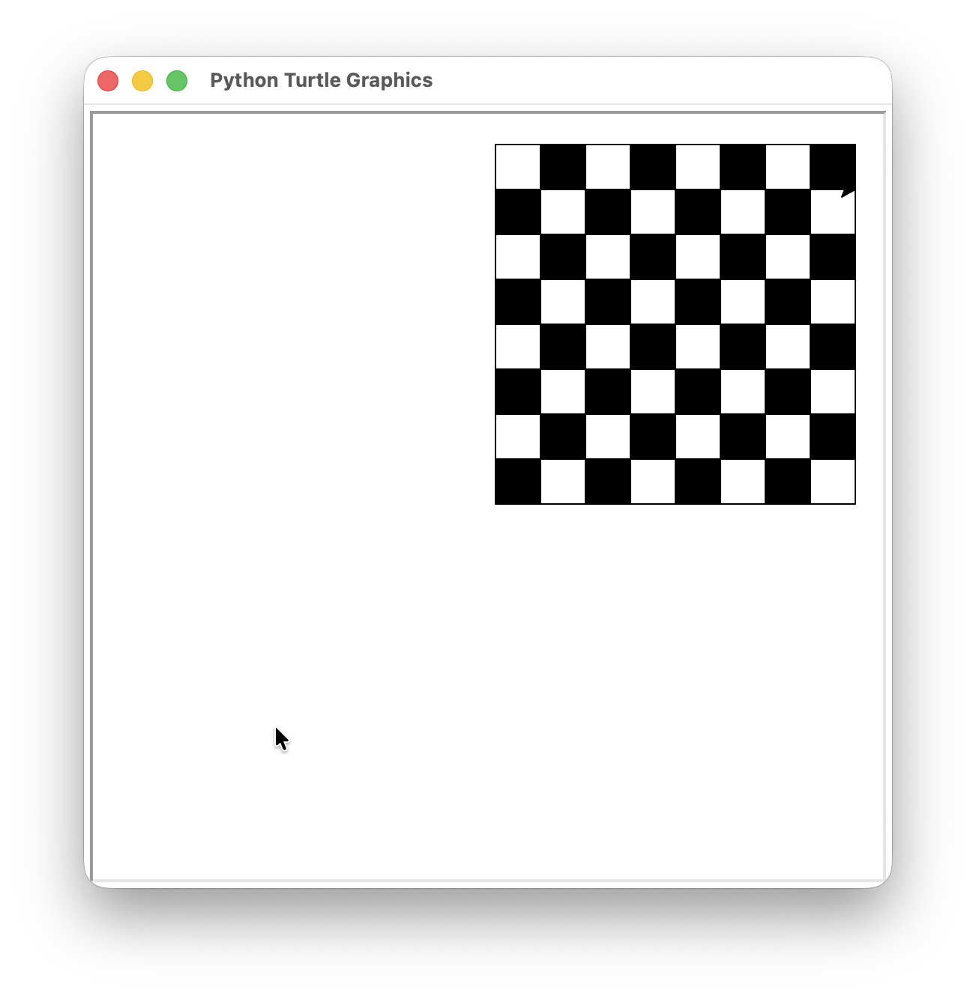 | **[Chessboard](patterns/chessboard.py)**<br>An 8 × 8 board drawn square by square, coloring each square by whether its row plus column number is even or odd.<br><br>**Concepts:** `nested loops` `modulo` `filled squares`<br>**Run:** `python3 patterns/chessboard.py` |
|  | **[Rainbow Mandala](patterns/rainbow_mandala.py)**<br>180 rhombus-and-loop motifs spaced 2° apart around a circle, colored by stepping the hue with `colorsys`.<br><br>**Concepts:** `HSV color` `nested loops` `tracer()`<br>**Run:** `python3 patterns/rainbow_mandala.py` |
|  | **[Yellow and Red Flower](patterns/yellow_red_flower.py)**<br>480 alternating yellow and red petals, each drawn as two arcs, shrinking every round so they stack into a dense flower.<br><br>**Concepts:** `circle(radius, extent)` `nested loops` `color cycling`<br>**Run:** `python3 patterns/yellow_red_flower.py` |

### Spirals

| Preview | Script |
| :---: | :--- |
| 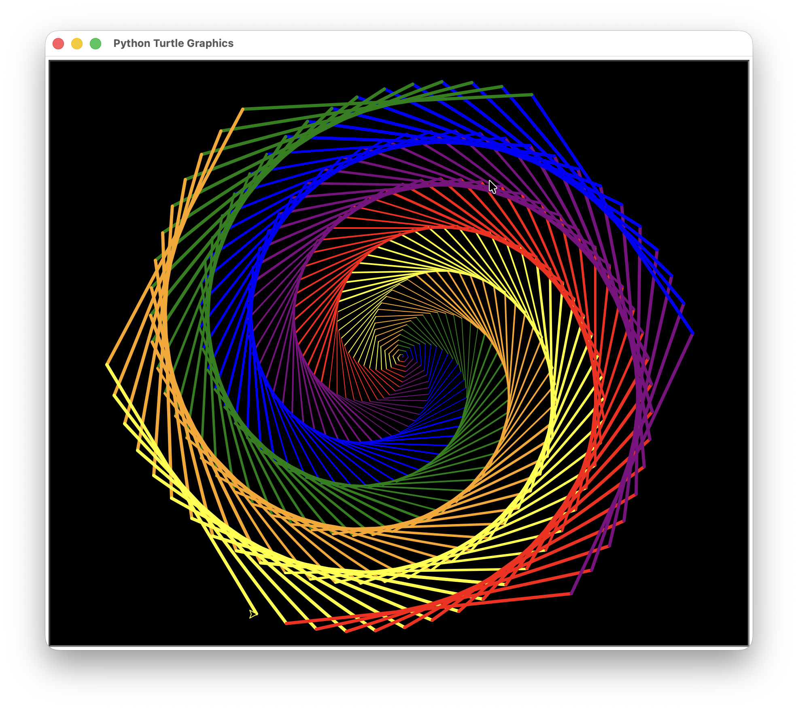 | **[Rainbow Hexagon Spiral](spirals/rainbow_hexagon_spiral.py)**<br>Hexagons that twist into a spiral because each turn is 59° instead of 60°, cycling six colors as the lines grow longer and thicker.<br><br>**Concepts:** `modulo color cycling` `integer division` `turning angles`<br>**Run:** `python3 spirals/rainbow_hexagon_spiral.py` |
| 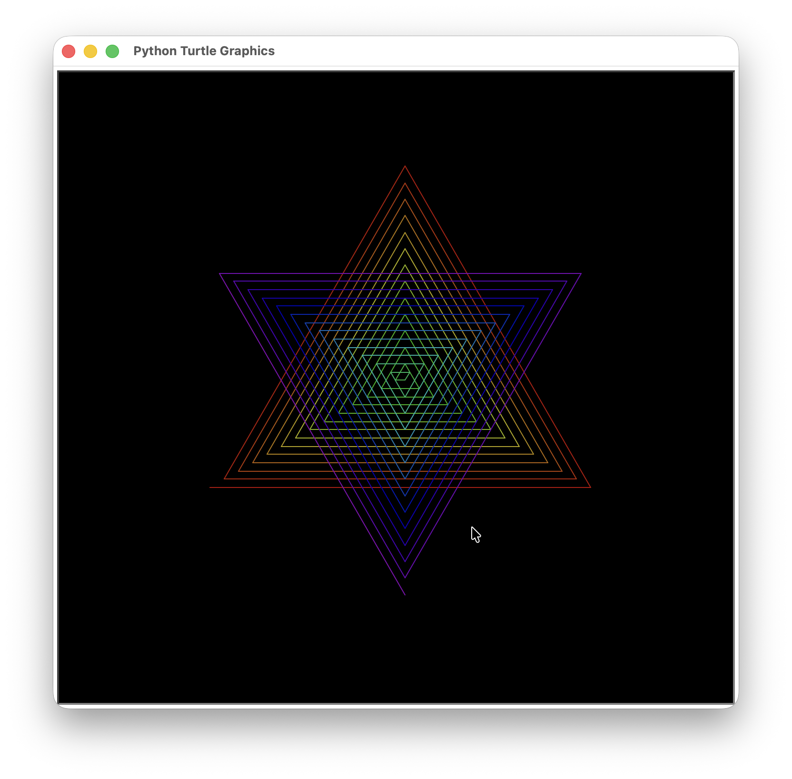 | **[Rainbow Hexagram](spirals/rainbow_hexagram.py)**<br>A six-pointed star drawn as one rainbow triangle spiral whose line length shrinks past zero, so the turtle walks backwards into the inverted triangle.<br><br>**Concepts:** `HSV color` `negative distances` `loop state`<br>**Run:** `python3 spirals/rainbow_hexagram.py` |
| 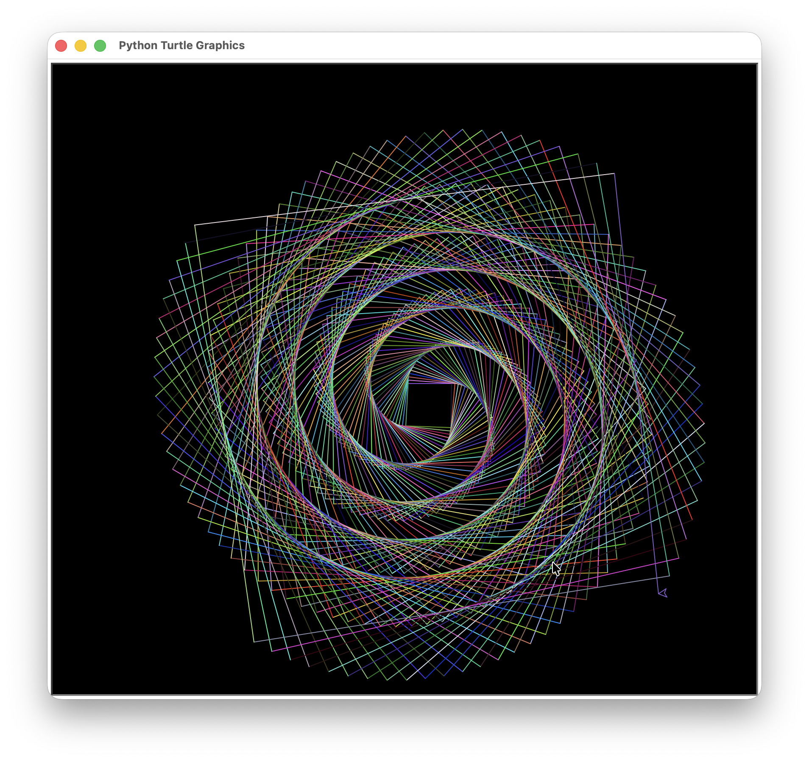 | **[Random Color Square Spiral](spirals/random_color_square_spiral.py)**<br>Squares that twist into a web because each turn overshoots 90° slightly, with every line in a random RGB color that changes on each run.<br><br>**Concepts:** `random` `RGB colors` `functions returning tuples`<br>**Run:** `python3 spirals/random_color_square_spiral.py` |
| 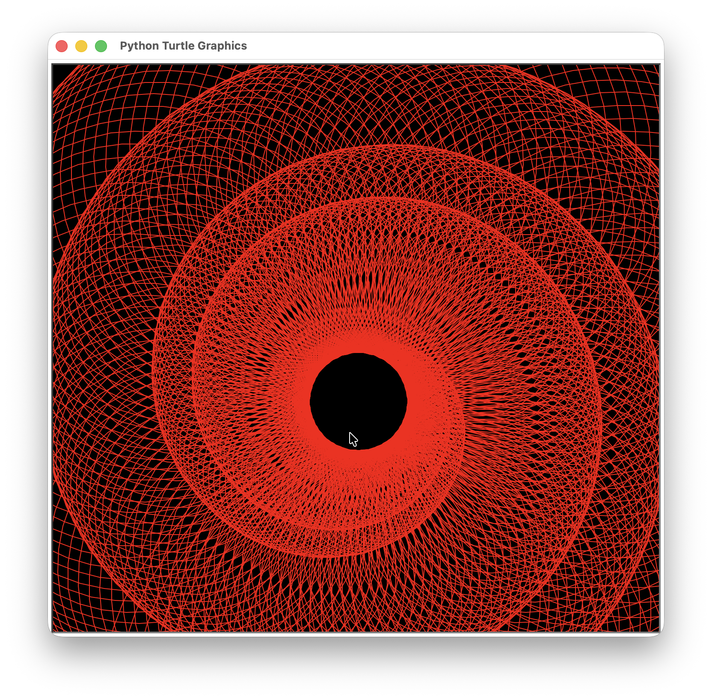 | **[Red Circle Vortex](spirals/red_circle_vortex.py)**<br>500 pairs of growing red circles drawn as the turtle slowly walks a small loop, piling up into a tunnel around a black hole ([full-screen view](spirals/red_circle_vortex_fullscreen.png)).<br><br>**Concepts:** `circle()` `growing radii` `small repeated turns`<br>**Run:** `python3 spirals/red_circle_vortex.py` |
| 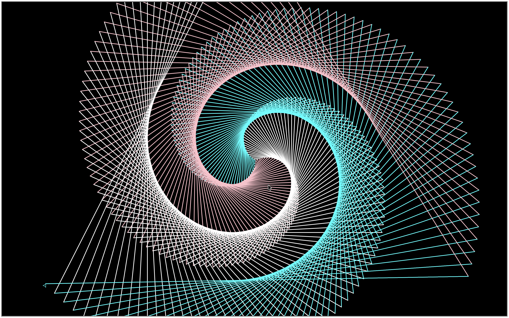 | **[Tricolor Triangle Spiral](spirals/tricolor_triangle_spiral.py)**<br>Ever-longer lines turning 121°, one degree past a triangle, so white, pink and cyan triangles swirl into three twisting arms.<br><br>**Concepts:** `modulo color cycling` `turning angles` `loops`<br>**Run:** `python3 spirals/tricolor_triangle_spiral.py` |

## Console programs

### Basics

| Preview | Script |
| :---: | :--- |
| *No screenshot: shows a desktop notification* | **[Break Reminder](basics/break_reminder.py)**<br>A background loop that shows a "take a break" desktop notification every hour, using the third-party plyer package.<br><br>**Concepts:** `third-party packages` `time.sleep()` `exception handling`<br>**Run:** `python3 basics/break_reminder.py` |
| 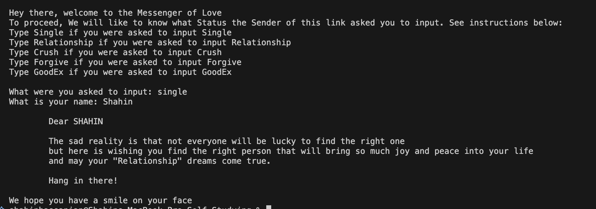 | **[Message Generator](basics/love_messenger.py)**<br>A template-based CLI message generator that fills one of five message templates with the names the user enters.<br><br>**Concepts:** `str.format() templates` `dictionaries` `textwrap`<br>**Run:** `python3 basics/love_messenger.py` |
| 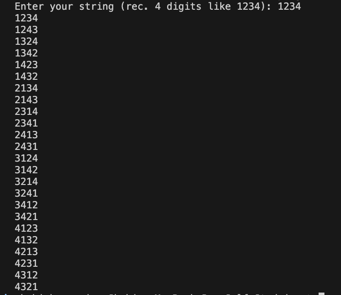 | **[String Permutations](basics/string_permutations.py)**<br>Prints every ordering of a string's characters with `itertools.permutations`, so `1234` gives 24 lines.<br><br>**Concepts:** `itertools` `str.join()` `factorial growth`<br>**Run:** `python3 basics/string_permutations.py` |

### Games

| Preview | Script |
| :---: | :--- |
| 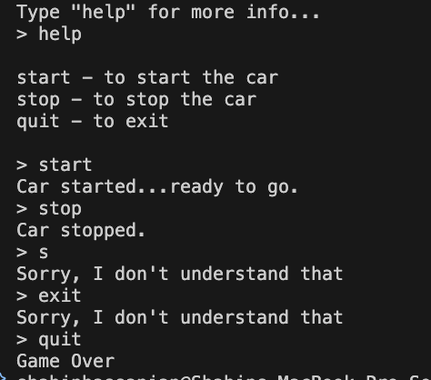 | **[Car Simulator](games/car_simulator.py)**<br>A command loop that starts and stops an imaginary car, tracking its state to warn about repeated commands.<br><br>**Concepts:** `while loops` `if/elif` `state flags`<br>**Run:** `python3 games/car_simulator.py` |
| 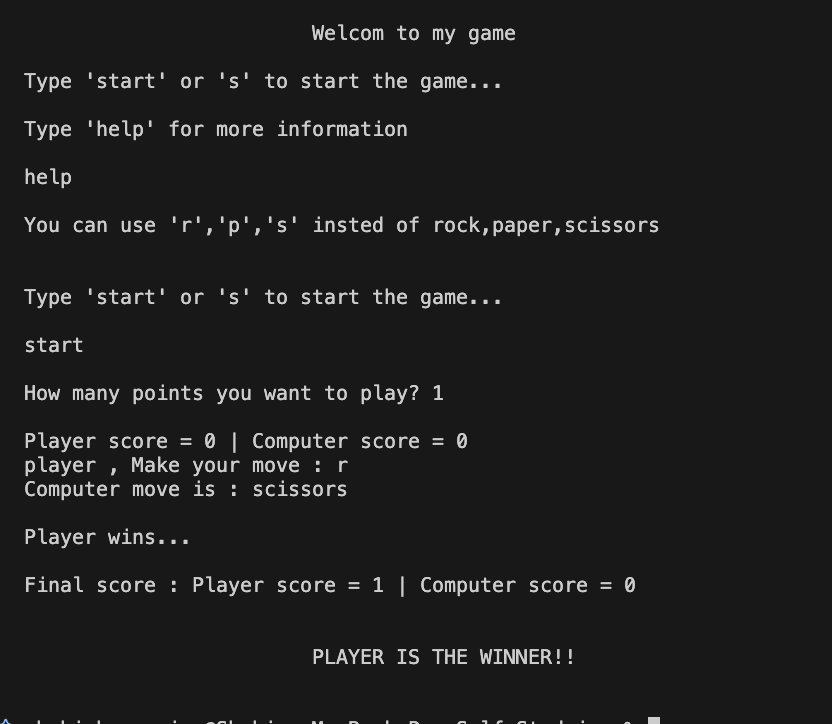 | **[Rock, Paper, Scissors](games/rock_paper_scissors.py)**<br>A first-to-N game against a random computer opponent, with input validation, `r`/`p`/`s` shortcuts and dictionary-based win rules.<br><br>**Concepts:** `random.choice()` `dictionaries` `input validation`<br>**Run:** `python3 games/rock_paper_scissors.py` |

## What I practiced

- **Loops and modulo:** color cycling and checkerboard patterns ([Rainbow Hexagon Spiral](spirals/rainbow_hexagon_spiral.py), [Chessboard](patterns/chessboard.py))
- **HSV color:** smooth rainbows with `colorsys` ([Rainbow Mandala](patterns/rainbow_mandala.py), [Rainbow Hexagram](spirals/rainbow_hexagram.py))
- **Randomness:** random colors and computer moves ([Random Color Square Spiral](spirals/random_color_square_spiral.py), [Rock, Paper, Scissors](games/rock_paper_scissors.py))
- **Geometry:** near-miss angles that make shapes twist and spread ([Tricolor Triangle Spiral](spirals/tricolor_triangle_spiral.py), [Yellow and Red Flower](patterns/yellow_red_flower.py))
- **Filled shapes:** logos built from layered fills ([Avengers Logo](logos/avengers_logo.py), [Windows Logo](logos/windows_logo.py))
- **Functions:** small helpers that take the pen and parameters ([Chessboard](patterns/chessboard.py), [Rainbow Mandala](patterns/rainbow_mandala.py))
- **Input handling:** validation, case-insensitive commands and clean Ctrl+C exits ([Rock, Paper, Scissors](games/rock_paper_scissors.py), [Car Simulator](games/car_simulator.py))
- **Libraries:** `itertools`, `textwrap` and a third-party package ([String Permutations](basics/string_permutations.py), [Message Generator](basics/love_messenger.py), [Break Reminder](basics/break_reminder.py))

## Code style

Every script follows PEP 8 and PEP 257. Each has a docstring describing its output and a `main()` function behind an `if __name__ == "__main__":` guard, and each exits cleanly: `turtle.done()` keeps drawings open, and console programs print a short goodbye on Ctrl+C.

## License

Licensed under the [GNU General Public License v3.0](LICENSE).
